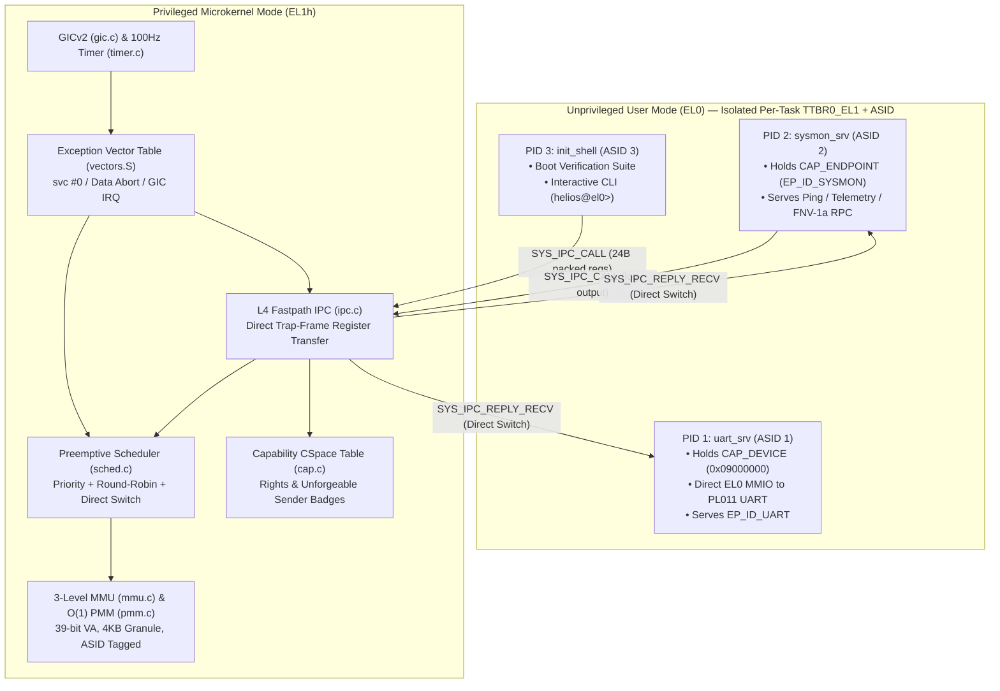
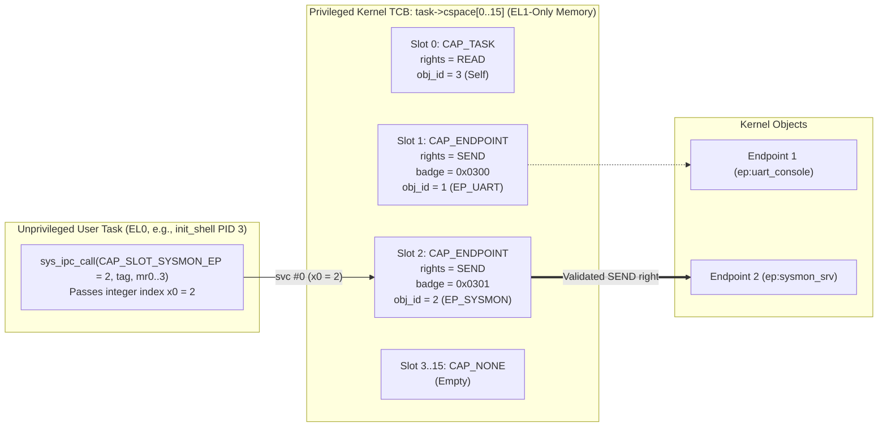
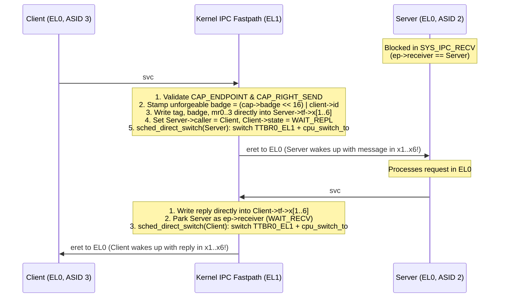

# Helios64 Microkernel — Detailed Architecture & Implementation Reference

This document provides a comprehensive technical deep dive into the architecture, memory layout, hardware abstractions, and internal implementation of **Helios64**, a 64-bit ARMv8-A (`AArch64`) L4-style microkernel.

---

## Table of Contents

1. [Microkernel Philosophy & System Overview](#1-microkernel-philosophy--system-overview)
2. [Hardware Target & Physical Memory Map](#2-hardware-target--physical-memory-map)
3. [Linker Script & Section Isolation](#3-linker-script--section-isolation)
4. [Boot Sequence & Exception Level Transitions (`kernel/boot.S`)](#4-boot-sequence--exception-level-transitions-kernelboots)
5. [Exception Vector Table, Trap Frames, & Context Switching (`kernel/vectors.S`)](#5-exception-vector-table-trap-frames--context-switching-kernelvectorss)
6. [Physical Memory Manager (`kernel/pmm.c`)](#6-physical-memory-manager-kernelpmmc)
7. [3-Level ASID-Tagged MMU & Virtual Address Spaces (`kernel/mmu.c`)](#7-3-level-asid-tagged-mmu--virtual-address-spaces-kernelmmuc)
8. [Capability-Based Access Control (`kernel/cap.c`)](#8-capability-based-access-control-kernelcapc)
9. [L4-Style Synchronous Register IPC & Direct Process Switch (`kernel/ipc.c`)](#9-l4-style-synchronous-register-ipc--direct-process-switch-kernelipcc)
10. [Interrupts (`GICv2`), Generic Timer, & Preemptive Scheduler](#10-interrupts-gicv2-generic-timer--preemptive-scheduler)
11. [System Call ABI & MMU Fault Isolation Guard (`kernel/trap.c`)](#11-system-call-abi--mmu-fault-isolation-guard-kerneltrapc)
12. [User-Space (`EL0`) Services & Zero-Copy Console Protocol (`user/`)](#12-user-space-el0-services--zero-copy-console-protocol-user)

---

## 1. Microkernel Philosophy & System Overview

Helios64 is designed around the **L4 / seL4 second-generation microkernel principle**: a mechanism belongs inside the privileged kernel (`EL1`) *if and only if* placing it in user space (`EL0`) would prevent the system from enforcing isolation or multiplexing hardware resources.

Consequently, the `EL1` kernel provides only five core abstractions:
1. **Virtual Address Spaces (`vspace_t`)**: Hardware-enforced memory protection via ARMv8-A 3-level page tables tagged with 16-bit hardware `ASID`s.
2. **Threads / Tasks (`task_t`)**: Execution contexts scheduled preemptively by priority and time-slice quantum.
3. **Capabilities (`capability_t`)**: Unforgeable kernel-managed tokens granting fine-grained authority over endpoints, device MMIO pages, and tasks.
4. **Synchronous Endpoints (`ipc_endpoint_t`)**: Rendezvous portals for zero-copy register-based message passing with direct context switching.
5. **Interrupt & Timer Routing**: Minimal `GICv2` and ARMv8 Generic Physical Timer drivers.

All higher-level services—including the **PL011 Serial Console Driver (`uart_srv`)**, the **System Telemetry & RPC Server (`sysmon_srv`)**, and the **Interactive Shell (`init_shell`)**—execute in unprivileged **`EL0` user mode**, each confined to its own virtual address space (`TTBR0_EL1`) and private user stack (`SP_EL0`).



---

## 2. Hardware Target & Physical Memory Map

Helios64 targets the QEMU `virt` machine (`-M virt -cpu cortex-a72 -m 128M`). The physical address space (`include/arch.h`) is organized as follows:

| Physical Address Range | Size | Constant | Description |
| :--- | :--- | :--- | :--- |
| `0x08000000` – `0x0800FFFF` | 64 KB | `VIRT_GICD_BASE` | ARM GICv2 Interrupt Distributor registers |
| `0x08010000` – `0x0801FFFF` | 64 KB | `VIRT_GICC_BASE` | ARM GICv2 CPU Interface registers |
| `0x09000000` – `0x09000FFF` | 4 KB | `VIRT_UART0_BASE` | PrimeCell PL011 UART0 MMIO registers (SPI IRQ 33) |
| `0x40080000` – `0x40087FFF` | 32 KB | `__text_start .. __rodata_end` | Executable instructions & read-only constants |
| `0x40088000` – `0x4008FFFF` | 32 KB | `__data_start .. __kernel_end` | Kernel `.data`, `.bss`, and 16 KB initial boot stack |
| `0x40090000` – `0x48000000` | ~127.5 MB | `g_pool_start .. PHYS_RAM_END` | Dynamic 4 KB page frame pool (32,624 frames) |

---

## 3. Linker Script & Section Isolation

The linker script (`linker.ld`) places the kernel entry point `_start` at `0x40080000` and enforces **4 KB page alignment (`ALIGN(4096)`)** between every major section:

```text
0x40080000  +----------------------------------------------------+  __kernel_start / __text_start
            | .text.boot (Entry point _start)                    |
            | .text.vectors (2048-byte aligned VBAR_EL1 table)   |  Mapped: PTE_AP_EL0_RO
            | .text (Kernel & EL0 code)                          |  (Read/Exec, Write-Protected)
            +----------------------------------------------------+  __text_end / __rodata_start
            | .rodata (Read-only strings & constants)            |
0x40088000  +----------------------------------------------------+  __rodata_end / __data_start
            | .data (Initialized kernel variables)               |
            | .bss (Task table, Endpoint table, PMM bitmap)      |  Mapped: PTE_AP_EL1_RW | PTE_UXN
            | Boot / Idle Stack (16 KB: __boot_stack_bottom..top)|  (Strictly EL1-Only! EL0 Faults!)
0x40090000  +----------------------------------------------------+  __kernel_end
            | Dynamic Physical Page Frame Pool (~127.5 MB)       |  Managed by PMM (pmm.c)
0x48000000  +----------------------------------------------------+  PHYS_RAM_END
```

Crucially, user-space (`EL0`) services in `user/*.c` keep all mutable state in local variables on their dynamically allocated private user stacks (`0x70000000..0x70002000`) rather than in global `.data`/`.bss` variables. This allows the entire `.data`, `.bss`, boot stack, and physical frame pool (`0x40088000..0x48000000`) to be locked down with **`PTE_AP_EL1_RW | PTE_UXN`** (Privileged Read/Write only, Unprivileged No-Access).

---

## 4. Boot Sequence & Exception Level Transitions (`kernel/boot.S`)

When the processor starts at `_start`:

1. **Multiprocessor Filtering**:
   Reads `mpidr_el1`, masks the lowest 8 affinity bits (`and x0, x0, #0xFF`), and places any secondary cores (`CPU != 0`) into a low-power `wfe` loop (`.Lpark_cpu`).
2. **Exception Level Normalization (`EL3` $\rightarrow$ `EL2` $\rightarrow$ `EL1h`)**:
   Reads `CurrentEL`:
   - **If in `EL3`**: Sets `SCR_EL3` (`NS | HCE | RW`), sets `SPSR_EL3 = 0x3C9` (`EL2h`), points `ELR_EL3` to `.Lfrom_el2`, and executes `eret`.
   - **If in `EL2`**: Sets `HCR_EL2.RW = 1` (AArch64 execution in `EL1`), enables `EL1`/`EL0` physical timer access in `CNTHCTL_EL2` (`EL1PCTEN | EL1PCEN`), zeroes `CNTVOFF_EL2`, sets `SPSR_EL2 = 0x3C5` (`EL1h` with `DAIF` masked), points `ELR_EL2` to `.Lat_el1`, and executes `eret`.
3. **`EL1` Environment Setup (`.Lat_el1`)**:
   - Enables Floating-Point and SIMD access for both `EL1` and `EL0` (`CPACR_EL1.FPEN = 0b11`) followed by `isb`.
   - Loads `VBAR_EL1` with `exception_vector_table`.
   - Initializes `SP_EL1` to `__boot_stack_top`.
   - Zeroes the `.bss` section (`__bss_start` to `__bss_end`) 8 bytes at a time.
   - Enables `EL0` read access to the hardware physical counter (`CNTKCTL_EL1.EL0PCTEN = 1`) so user-space tasks can execute `mrs x0, cntpct_el0` directly for sub-microsecond latency measurements.
   - Calls `kernel_main()` in `kernel/main.c`.

---

## 5. Exception Vector Table, Trap Frames, & Context Switching (`kernel/vectors.S`)

### 5.1 ARMv8-A Exception Vector Table
The vector table (`exception_vector_table`) is aligned to $2^{11} = 2048$ bytes and contains 16 entries grouped into 4 blocks of 4 exception types (`Synchronous`, `IRQ`, `FIQ`, `SError`), with each entry occupying 128 bytes (`.align 7`):
- **Current EL with `SP_EL0` (`EL1t`)**
- **Current EL with `SP_EL1` (`EL1h`)**: Dispatches to `el1_sync_entry` and `el1_irq_entry`.
- **Lower EL using AArch64 (`EL0`)**: Dispatches to `el0_sync_entry` (`svc #0` syscalls and `EL0` MMU aborts) and `el0_irq_entry` (preemptive timer ticks and UART interrupts while in user mode).
- **Lower EL using AArch32**: Dispatches to `unhandled_vec_entry`.

### 5.2 Trap Frame (`trap_frame_t`) vs. Callee Context (`cpu_context_t`)
Helios64 separates exception state saving from scheduler context switching:

1. **`trap_frame_t` (272 bytes on the task's kernel stack)**:
   Constructed by the `SAVE_TRAP_FRAME` macro upon any exception entry (`EL0 -> EL1` or `EL1 -> EL1`) and popped by `RESTORE_TRAP_FRAME` before `eret`:
   ```c
   typedef struct trap_frame {
       uint64_t x[31];         /* x0 .. x30 (248 bytes) */
       uint64_t sp_el0;        /* User stack pointer SP_EL0 (8 bytes) */
       uint64_t elr_el1;       /* Exception return PC ELR_EL1 (8 bytes) */
       uint64_t spsr_el1;      /* Saved processor state SPSR_EL1 (8 bytes) */
   } ALIGNED(16) trap_frame_t; /* Total = 272 bytes */
   ```
2. **`cpu_context_t` (104 bytes inside `task_t`)**:
   Used by `cpu_switch_to(cpu_context_t *prev, cpu_context_t *next)` in `kernel/boot.S` to switch execution between two kernel stacks. Because the C compiler already preserves caller-saved registers (`x0..x18`) across function calls under the ARM64 AAPCS64 ABI, `cpu_switch_to` only saves and restores the callee-saved registers (`x19..x28`), frame pointer (`x29`), link register (`x30`), and stack pointer (`sp`).

### 5.3 First-Time Task Entry (`ret_from_fork`)
When a new task is created, its `context.x30` (return address) is set to `ret_from_fork`:
- For a **kernel thread (`EL1`)**, `context.x19` holds the function pointer; `ret_from_fork` unmasks IRQs (`msr daifclr, #2`) and branches to `x19`.
- For a **user task (`EL0`)**, `context.x19 = 0` and `context.sp` points to a pre-built `trap_frame_t` at the top of the task's kernel stack; `ret_from_fork` executes `RESTORE_TRAP_FRAME` and `eret` into `EL0`.

---

## 6. Physical Memory Manager (`kernel/pmm.c`)

`pmm.c` manages physical 4 KB frames from `__kernel_end` (`0x40090000`) to `PHYS_RAM_END` (`0x48000000`):
- **Data Structure**: A flat bit-array `g_page_bitmap[512]` of 64-bit words where 1 bit represents 1 physical 4 KB page ($512 \times 64 = 32,768$ pages = 128 MB).
- **$O(1)$ Allocation (`pmm_alloc_page`)**:
  - Scans `g_page_bitmap` starting at `g_search_hint` (the index of the 64-bit word where the last allocation or deallocation occurred).
  - As soon as it finds a word `word != ~0ULL`, it executes `__builtin_ctzll(~word)` (compiled to `mvn` + `rbit` + `clz` instructions) to find the exact index of the first zero bit in a single CPU cycle.
  - Marks the bit as used, updates `g_search_hint`, zeroes the 4 KB physical frame, and returns its physical address.
- **Contiguous Multi-Page Allocation (`pmm_alloc_pages`)**:
  - Used for 8 KB kernel stacks (`KERNEL_STACK_PAGES = 2`) and 8 KB user stacks (`USER_STACK_PAGES = 2`).

---

## 7. 3-Level ASID-Tagged MMU & Virtual Address Spaces (`kernel/mmu.c`)

### 7.1 Address Translation Geometry
Helios64 configures `TCR_EL1` with `T0SZ = 25`, `T1SZ = 25`, and 4 KB granule (`TG0 = 0b00`), yielding a **39-bit (512 GB) virtual address space** resolved across 3 page table levels (`L1`, `L2`, `L3`). Each table is a 4 KB page containing $512 \times 8$-byte descriptors:

- **L1 Index (`bits [38:30]`)**: Each entry covers 1 GB and points to an L2 page table.
- **L2 Index (`bits [29:21]`)**: Each entry covers 2 MB and points to an L3 page table.
- **L3 Index (`bits [20:12]`)**: Each entry covers a 4 KB page frame with fine-grained access permissions (`AP[2:1]`), execute-never bits (`PXN`, `UXN`), memory attribute index (`AttrIndx[2:0]`), shareability (`SH[1:0]`), access flag (`AF`), and non-global flag (`nG`).
- **Page Offset (`bits [11:0]`)**: Byte offset within the 4 KB page (`0..4095`).

### 7.2 Per-Task Virtual Address Space (`vspace_t`) & Hardware ASIDs
Each task owns a `vspace_t` containing its `l1_table` pointer and a unique 16-bit `asid`:
- **Kernel Idle (`PID 0`)**: `ASID 0`
- **`uart_srv` (`PID 1`)**: `ASID 1` (includes private `EL0` RW mapping for `0x09000000` UART0 MMIO and private user stack at `0x70000000..0x70002000`)
- **`sysmon_srv` (`PID 2`)**: `ASID 2` (includes private user stack at `0x70000000..0x70002000` backed by distinct physical frames)
- **`init_shell` (`PID 3`)**: `ASID 3` (includes private user stack at `0x70000000..0x70002000` backed by distinct physical frames)

When switching between tasks, `mmu_switch_vspace(vspace_t *vs)` writes both the new `l1_table` physical address and the 16-bit `ASID` into `TTBR0_EL1`:
```c
uint64_t ttbr0 = ((uint64_t)vs->asid << 48) | ((uintptr_t)vs->l1_table & PTE_ADDR_MASK);
__asm__ volatile("msr ttbr0_el1, %0\n\tisb" :: "r"(ttbr0) : "memory");
```
Because user mappings are marked Non-Global (`PTE_NG`), the ARM64 TLB tags cached translations with the `ASID`, **eliminating the need for TLB invalidations (`tlbi`) on context switches and IPC calls**.

---

## 8. Capability-Based Access Control (`kernel/cap.c`)

### 8.1 What is a Capability? (Capabilities vs. Traditional ACLs)

In traditional monolithic operating systems (like Unix/Linux), security is based on **Access Control Lists (ACLs)** and **Ambient Authority**:
- Every process runs under a global identity (e.g., `uid = 1000` or `root`).
- Resources reside in a global namespace (e.g., `/dev/ttyAMA0`, PIDs, sockets).
- When a process requests an operation, it names the target resource using a global identifier, and the kernel checks whether the process's `uid` has permission.
- **The Problem (Ambient Authority & The Confused Deputy)**: Because a privileged daemon carries its broad `uid` authority on *every* action it takes, an unprivileged client can trick a privileged service (the "deputy") into misusing its authority on a resource the client shouldn't have access to.

In a **Capability-Based Microkernel** (like seL4, Fuchsia/Zircon, and Helios64), there is **no ambient authority** and **no global namespace** accessible to user space:
- A **Capability** is an **unforgeable token of authority** that simultaneously:
  1. **Names** a specific kernel object (an IPC Endpoint, a physical MMIO Device page, a Memory Frame, or a Task), and
  2. **Encodes the exact access rights** (`READ`, `WRITE`, `SEND`, `RECV`, `GRANT`) the holder is allowed to exercise on that object.
- If a task does not possess a capability to an object in its private table, **it cannot even name or address that object**—let alone access it.

---

### 8.2 Per-Task Capability Space (`CSpace`) Architecture

In Helios64, capabilities are stored exclusively inside privileged kernel memory (`EL1`-only `.bss`) within each task's Task Control Block (`task->cspace[MAX_CAPS_PER_TASK]` in `include/sched.h`). User-space code in `EL0` **cannot read or modify its `CSpace` directly** (doing so triggers an MMU Data Abort).

Instead, user-space code refers to capabilities using an integer slot index (`cap_slot` $\in [0, 15]$), analogous to an unforgeable hardware-isolated file descriptor:



### 8.3 Capability Structure, Object Types, & Rights Bitmask (`include/cap.h`)

Each entry in `task->cspace[]` is an 16-byte `capability_t` struct:

```c
typedef struct capability {
    uint8_t    type;        /* Object type (cap_type_t) */
    uint8_t    rights;      /* Access rights bitmask (CAP_RIGHT_*) */
    uint16_t   badge;       /* Unforgeable 16-bit badge stamped by kernel on IPC */
    uint32_t   obj_id;      /* Kernel object ID (Endpoint ID, Task ID, or page count) */
    uintptr_t  phys_base;   /* Physical base address (for CAP_FRAME / CAP_DEVICE) */
} capability_t;
```

#### Capability Object Types (`cap_type_t`)
1. **`CAP_NONE` (`0`)**: Empty/unallocated capability slot. Any lookup on this slot fails immediately with `EPERM`.
2. **`CAP_ENDPOINT` (`1`)**: References a kernel synchronous IPC endpoint (`g_endpoints[obj_id]`).
   - With `CAP_RIGHT_SEND`: Allows the holder to invoke `SYS_IPC_CALL` or `SYS_IPC_SEND` to send messages to the endpoint.
   - With `CAP_RIGHT_RECV`: Allows the holder (a server) to invoke `SYS_IPC_RECV` or `SYS_IPC_REPLY_RECV` to listen for incoming client messages on the endpoint.
3. **`CAP_FRAME` (`2`)**: References a physical RAM page frame (`phys_base`) that can be mapped into a virtual address space.
4. **`CAP_DEVICE` (`3`)**: References a hardware MMIO register page (`phys_base`, such as `0x09000000` for PL011 UART0). Required to perform privileged device operations or map hardware registers into a user-space driver (`uart_srv`).
5. **`CAP_TASK` (`4`)**: Authority over a Task Control Block (`obj_id = task_id`).

#### Access Rights Bitmask (`uint8_t rights`)
| Constant | Bit | Meaning |
| :--- | :--- | :--- |
| `CAP_RIGHT_READ` | `1 << 0` (`0x01`) | Read state or MMIO registers |
| `CAP_RIGHT_WRITE` | `1 << 1` (`0x02`) | Modify state or MMIO registers |
| `CAP_RIGHT_SEND` | `1 << 2` (`0x04`) | Send IPC messages to an endpoint |
| `CAP_RIGHT_RECV` | `1 << 3` (`0x08`) | Receive IPC messages from an endpoint |
| `CAP_RIGHT_GRANT` | `1 << 4` (`0x10`) | Delegate/transfer capabilities to another task |

---

### 8.4 Unforgeable Sender Badges (`badge`)

When multiple clients (`sysmon_srv`, `init_shell`, etc.) share `SEND` access to the same server endpoint (such as `EP_ID_UART` or `EP_ID_SYSMON`), how does the server know *which* client sent a message, and what authority that client holds, without trusting a user-supplied PID that a malicious client could spoof?

Helios64 solves this using **L4/seL4 Capability Badges**:
1. When the kernel grants an endpoint capability to a task via `cap_grant()`, it embeds a 16-bit `badge` inside that specific `capability_t` slot in kernel memory:
   - `sysmon_srv` (PID 2) gets `EP_ID_UART` with `badge = 0x0200`.
   - `init_shell` (PID 3) gets `EP_ID_UART` with `badge = 0x0300` and `EP_ID_SYSMON` with `badge = 0x0301`.
2. When a client calls `SYS_IPC_CALL(cap_slot, tag, mr0..mr3)`, the client **cannot specify the badge**. Instead, `sys_ipc_call_handler()` in `kernel/ipc.c` reads `cap->badge` directly from the client's kernel `CSpace` and stamps a 32-bit hardware-verified token into register `x2` of the receiving server's trap frame:
   ```c
   uint64_t badge = ((uint64_t)cap->badge << 16) | (client->id & 0xFFFFU);
   ```
3. When `sysmon_srv` wakes up from `SYS_IPC_RECV`, `msg.badge` equals `0x03010003` (`badge = 0x0301`, `PID = 3`), which is guaranteed by the kernel to be unforgeable.

---

### 8.5 Fast Constant-Time Capability Validation (`cap_lookup`)

Every capability-checked system call invokes `cap_lookup()` (`kernel/cap.c`), which validates the slot index, object type, and required rights in **constant $O(1)$ time (just a bounds check, array index, and two bitwise comparisons)**:

```c
const capability_t *cap_lookup(struct task *t, uint32_t slot,
                               cap_type_t expected_type, uint8_t required_rights) {
    if (!t || slot >= MAX_CAPS_PER_TASK) {
        return NULL;
    }
    const capability_t *cap = &t->cspace[slot];
    if (cap->type != (uint8_t)expected_type) {
        return NULL;
    }
    if ((cap->rights & required_rights) != required_rights) {
        return NULL;
    }
    return cap;
}
```

For example:
- If `init_shell` (PID 3) attempts to call `sys_ipc_recv(CAP_SLOT_UART_EP, &msg)` to eavesdrop on console messages sent by other tasks, `cap_lookup(cur, 1, CAP_ENDPOINT, CAP_RIGHT_RECV)` sees that `init_shell`'s slot 1 only has `CAP_RIGHT_SEND` (`0x04 & 0x08 == 0`) and immediately rejects the call with `EPERM (-3)`.
- If `init_shell` (PID 3) attempts to call `SYS_DEBUG_CONSOLE` to access the UART hardware directly, `cap_lookup(cur, CAP_SLOT_DEVICE_0, CAP_DEVICE, CAP_RIGHT_READ)` sees `CAP_NONE` in slot 3 and rejects the call with `EPERM (-3)`.

### 8.6 Capability Assignment Matrix at Boot (`kernel/main.c`)

| Task | Slot 0 (`CAP_SLOT_SELF_TASK`) | Slot 1 (`CAP_SLOT_UART_EP`) | Slot 2 (`CAP_SLOT_SYSMON_EP`) | Slot 3 (`CAP_SLOT_DEVICE_0`) |
| :--- | :--- | :--- | :--- | :--- |
| **`uart_srv` (PID 1)** | `CAP_TASK` (`R`, obj `1`) | `CAP_ENDPOINT` (`RECV \| SEND`, badge `0x0100`, obj `EP_ID_UART`) | `CAP_NONE` | `CAP_DEVICE` (`RW`, badge `0x0101`, phys `0x09000000`) |
| **`sysmon_srv` (PID 2)** | `CAP_TASK` (`R`, obj `2`) | `CAP_ENDPOINT` (`SEND`, badge `0x0200`, obj `EP_ID_UART`) | `CAP_ENDPOINT` (`RECV \| SEND`, badge `0x0201`, obj `EP_ID_SYSMON`) | `CAP_NONE` |
| **`init_shell` (PID 3)** | `CAP_TASK` (`R`, obj `3`) | `CAP_ENDPOINT` (`SEND`, badge `0x0300`, obj `EP_ID_UART`) | `CAP_ENDPOINT` (`SEND`, badge `0x0301`, obj `EP_ID_SYSMON`) | `CAP_NONE` |

---

## 9. L4-Style Synchronous Register IPC & Direct Process Switch (`kernel/ipc.c`)

Synchronous IPC is the performance-critical heart of any microkernel. Helios64 implements three optimizations inspired by L4:

### 9.1 Register-Only Message Transfer
Messages (`ipc_msg_t`) consist of a `tag`, a kernel-stamped `badge`, and four 64-bit message registers (`mr0..mr3`). During a syscall, these values reside in `x1..x6` of the task's `trap_frame_t`. No heap allocation or user-to-kernel buffer copying occurs.

### 9.2 L4 Fastpath Direct Switch (`sched_direct_switch`)
When Client Task A invokes `SYS_IPC_CALL` on an endpoint where Server Task B is already waiting in `TASK_BLOCKED_RECV`:



### 9.3 Combined `SYS_IPC_REPLY_RECV`
In a request-response loop, a server must send a reply to the previous client and immediately wait for the next incoming request. `SYS_IPC_REPLY_RECV` fuses both operations into a **single system call**, cutting kernel entry/exit overhead in half.

---

## 10. Interrupts (`GICv2`), Generic Timer, & Preemptive Scheduler

- **GICv2 (`kernel/gic.c`)**: Configures `GICD_CTLR` and `GICC_CTLR`, sets the priority mask `GICC_PMR = 0xFF`, routes SPI IRQ 33 (UART0 RX) to CPU 0, and unmasks PPI IRQ 30 (Physical Timer).
- **Generic Timer (`kernel/timer.c`)**: Reads `CNTFRQ_EL0` (62.5 MHz on QEMU `virt`) and programs `CNTP_TVAL_EL0 = 625000` for a **100 Hz (10 ms)** periodic tick.
- **Preemptive Scheduler (`kernel/sched.c`)**:
  - Each task has a `priority` (`0` = highest, `7` = `idle_el1`) and a `time_slice` of 5 ticks (50 ms).
  - On each timer IRQ (`trap_irq_handler`), sleeping tasks whose `wakeup_tick <= g_ticks` are transitioned to `TASK_READY`. If the running task's `time_slice` reaches 0, `sched_yield()` preempts it and selects the highest-priority `TASK_READY` task in round-robin order.

---

## 11. System Call ABI & MMU Fault Isolation Guard (`kernel/trap.c`)

### 11.1 System Call Table (`svc #0`, syscall number in `x8`)

| Syscall ID | Constant | Arguments (`x0..x5`) | Description |
| :--- | :--- | :--- | :--- |
| `0` | `SYS_YIELD` | — | Voluntarily yield remaining CPU quantum |
| `1` | `SYS_IPC_CALL` | `slot, tag, mr0..mr3` | Synchronous send + block waiting for reply |
| `2` | `SYS_IPC_RECV` | `slot` | Block waiting to receive on endpoint |
| `3` | `SYS_IPC_REPLY_RECV` | `slot, rtag, mr0..mr3` | Reply to caller and atomically wait for next message |
| `4` | `SYS_IPC_SEND` | `slot, tag, mr0..mr3` | One-way synchronous send |
| `5` | `SYS_SLEEP_MS` | `milliseconds` | Put current task to sleep for $N$ ms |
| `6` | `SYS_GET_TASK_INFO` | `task_id, user_ptr` | Copy task telemetry (`task_info_t`) to validated `EL0` buffer |
| `7` | `SYS_GET_SYS_INFO` | `user_ptr` | Copy PMM/MMU/IPC telemetry (`sys_info_t`) to validated `EL0` buffer |
| `8` | `SYS_CAP_INSPECT` | `slot, user_ptr` | Inspect capability slot in current task's `CSpace` |
| `9` | `SYS_FAULT_GUARD` | `recovery_pc` | Register an `EL0` fault recovery PC for MMU isolation self-tests |
| `10` | `SYS_SHUTDOWN` | — | Power off system cleanly via ARM PSCI (`0x84000008`) |
| `11` | `SYS_DEBUG_CONSOLE` | `op, arg` | Capability-checked RX FIFO pop (`CAP_DEVICE` required) |

All user pointers passed to `SYS_GET_TASK_INFO`, `SYS_GET_SYS_INFO`, and `SYS_CAP_INSPECT` are verified by `validate_user_ptr()`, which walks the task's 3-level page table to ensure every page is mapped with `PTE_AP_EL0_RW` before writing.

### 11.2 Hardware Fault Isolation (`trap_el0_sync`)
If an `EL0` task dereferences an unmapped address or attempts to read/write `EL1`-only kernel memory (`0x40088000..0x48000000`), the MMU triggers a Synchronous Data Abort from Lower EL (`ESR_EL1.EC = 0x24`). `trap_el0_sync` logs the syndrome (`ESR_EL1`), faulting address (`FAR_EL1`), and instruction pointer (`ELR_EL1`):
- If a fault guard was registered via `SYS_FAULT_GUARD`, the kernel redirects `tf->elr_el1` to `fault_recovery_pc` with `tf->x[0] = FAR_EL1` and resumes execution.
- Otherwise, it isolates the crash by marking the task `TASK_FAULTED` and scheduling the next runnable task.

---

## 12. User-Space (`EL0`) Services & Zero-Copy Console Protocol (`user/`)

1. **`user/ulib.c` — 24-Byte Register-Packed Console Client**:
   Instead of making one IPC call per character or sharing memory buffers, `u_puts()` and `u_printf()` pack **up to 24 characters into the three 64-bit registers `mr1`, `mr2`, and `mr3`** (with byte count in `mr0`) and invoke `SYS_IPC_CALL(CAP_SLOT_UART_EP, UART_IPC_WRITE_STR, ...)`.
2. **`user/uart_srv.c` — `PID 1` User-Space PL011 Serial Driver**:
   Executes in unprivileged `EL0` (`ASID 1`). Because `kernel_main` mapped physical page `0x09000000` (`VIRT_UART0_BASE`) into `uart_srv`'s `vspace` with `VM_USER_DEVICE` (`PTE_AP_EL0_RW`), `el0_uart_hw_putc()` writes directly to the PL011 `UART_DR` and polls `UART_FR` from user space without trapping into `EL1`.
3. **`user/sysmon_srv.c` — `PID 2` System Telemetry & RPC Server**:
   Executes in `EL0` (`ASID 2`), servicing `SYSMON_IPC_PING` (benchmark echo), `SYSMON_IPC_QUERY`, and `SYSMON_IPC_COMPUTE` (64-bit FNV-1a hashing) using `sys_ipc_reply_recv()`.
4. **`user/shell.c` — `PID 3` Boot Verification Suite & Interactive Shell**:
   Executes in `EL0` (`ASID 3`). On startup, it runs 10,000 synchronous IPC round-trips against `sysmon_srv` (measuring hardware cycles via `cntpct_el0`), verifies hardware MMU protection by intentionally triggering and recovering from an `EL0 -> EL1` Data Abort at `0x40088000`, prints the process table, and enters the interactive `helios@el0>` prompt.
